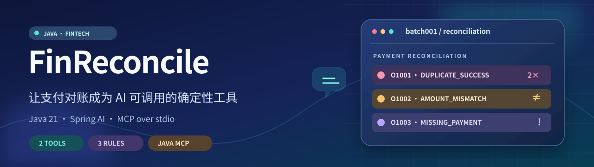
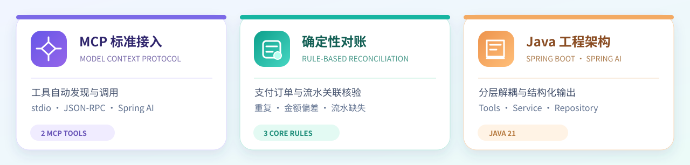
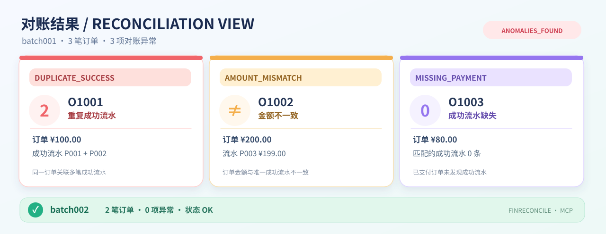
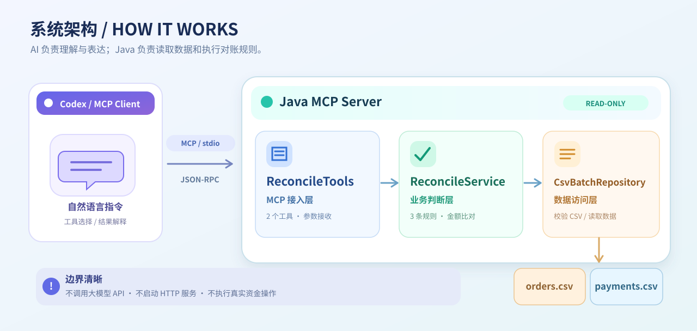

<div align="center">

# FinReconcile-MCP

**Java Payment Reconciliation · Model Context Protocol**

将支付对账逻辑封装为标准 MCP 工具，让 Codex 等 AI 客户端通过自然语言发起核验、获取结构化结果。

<p>
  
  
  
  
</p>

<a href="#项目亮点">项目亮点</a> · <a href="#功能预览">功能预览</a> · <a href="#系统架构">系统架构</a> · <a href="#快速体验">快速体验</a>

</div>

<div align="center">
  
</div>

## 项目亮点

<div align="center">
  
</div>

**让 AI 负责理解和表达，让 Java 负责业务判断。**

FinReconcile-MCP 基于 **Java 21 + Spring Boot + Spring AI** 构建，通过 MCP 向 AI 客户端开放支付对账能力。工具接口与业务规则解耦，可以直接接入支持 MCP 的客户端，无需单独开发 Agent 聊天页面。

## 功能预览

<div align="center">
  
</div>

只需要向 Codex 发送一句话：

> 请使用 FinReconcile MCP 列出可用批次，核验 batch001 和 batch002，并按订单归纳异常。

AI 客户端会自动发现并调用两个 MCP 工具：

| MCP Tool | 核心功能 |
| :--- | :--- |
| `list_batches` | 获取可用对账批次 |
| `reconcile_batch` | 按批次核验订单与成功支付流水，返回异常明细和整体状态 |

**三类核心对账规则**

| 异常类型 | 检测逻辑 |
| :--- | :--- |
| `DUPLICATE_SUCCESS` | 同一订单关联多笔不同 ID 的成功支付流水 |
| `AMOUNT_MISMATCH` | 订单金额与唯一成功支付流水金额不一致 |
| `MISSING_PAYMENT` | 已支付订单未关联成功支付流水 |

金额采用 `BigDecimal` 精确比较，异常结果按照订单号组织，便于 AI 生成直观的对账报告。

## 系统架构

<div align="center">
  
</div>

**Codex → MCP Server → ReconcileService → CsvBatchRepository**

客户端通过 `tools/list` 发现工具，通过 `tools/call` 发起请求；Spring AI 负责 MCP 协议接入，Java Service 执行对账规则，Repository 获取订单和流水数据。客户端与服务端采用 **stdio + JSON-RPC** 通信。

## 快速体验

在 **Windows / PowerShell** 环境中，准备好 **JDK 21**、Git 和 Codex CLI。`JAVA_HOME` 应指向 JDK 21 安装目录。

### ① 获取项目并构建

```powershell
git clone https://github.com/liandongjie/FinReconcile-MCP.git
cd FinReconcile-MCP
java -version
.\mvnw.cmd -B -ntp clean package
```

构建后生成 `target/fin-reconcile-mcp-1.0.0.jar`。

### ② 注册 MCP Server

```powershell
$javaExe = Join-Path $env:JAVA_HOME "bin\java.exe"
$jarFile = (Resolve-Path ".\target\fin-reconcile-mcp-1.0.0.jar").Path
$dataDir = (Resolve-Path ".\data").Path

codex mcp add fin-reconcile --env "FIN_RECONCILE_DATA_DIR=$dataDir" -- $javaExe -jar $jarFile
codex mcp list
```

### ③ 自然语言发起对账

在新的 Codex 会话中输入：

```text
使用 fin-reconcile 工具查看有哪些对账批次；
核验 batch001 和 batch002，并整理各订单的异常类型与判断依据。
```

预置数据中，`batch001` 对应三类异常，`batch002` 的核验状态为 `OK`。

---

<div align="center">

**FinReconcile-MCP · Build with Java & Spring AI**

[MIT License](LICENSE)

</div>
